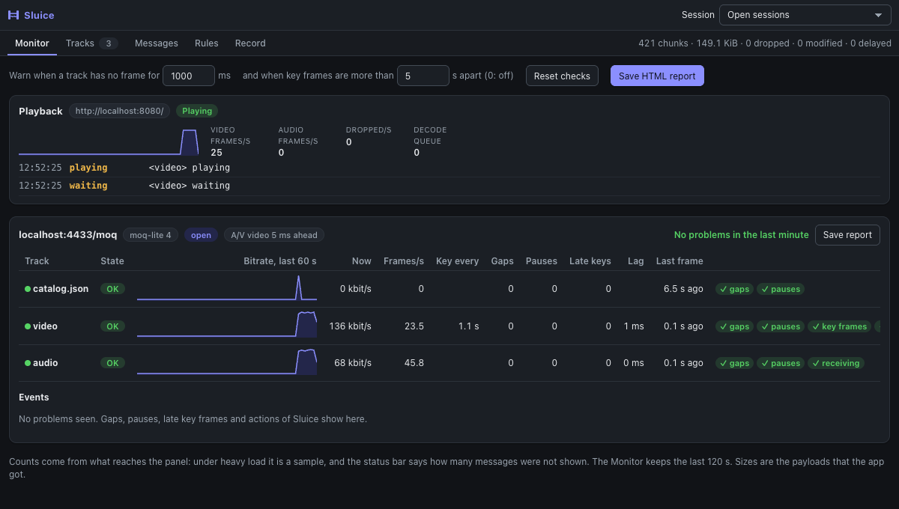
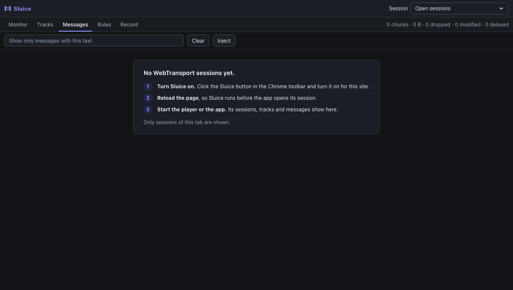

# Sluice

**See, change and replay the WebTransport and MoQ traffic of your app, inside Chrome, with no proxy.**



Sluice is a Chrome DevTools extension for people who build WebTransport and MoQ apps, such as a live video player. Open the
**Sluice** tab in DevTools, start your app, and you can:

- **Monitor** each MoQ track: bitrate chart, frames per second, key frame interval, and problems such as gaps, pauses and
  late key frames, with a report you can save.
- **See the player, not only the network**: frames that its WebCodecs decoders or its `<video>` show each second, decoder
  errors and freezes, next to the tracks.
- **Watch** each track in detail: catalog, codec, size, groups, frames and key frames, live.
- **Inspect** every message, with hex, text and JSON views. Frames show their track, group and frame number.
- **Break things on purpose**: drop key frames, lose frames, delay a track, edit the catalog, or use a mobile network. Start
  from a quick test with one switch, or build your own rules in Advanced.
- **Record** what the server sends, and **play it again with no server**, as many times as you need. Export a recording as a
  `.moqtrace` trace file for other MoQ tools, or open one to analyse it.
- **Share a report**: one HTML file with charts, checks and events, to attach to a ticket.
- **Act on the connection**: stall or close the session once, or reset streams, stall and close from a rule.
- **Inject** a message the server never sent.

It understands **moq-lite 3 to 6** and **IETF MoQT drafts 7 to 23**, with track names for both. Other WebTransport apps work too, as
datagrams and stream chunks.

> **Status: before the first store release.** Install it from source (2 minutes). Tested on Chromium only.

## Install

You need Node 22 or newer and [pnpm](https://pnpm.io/) (`corepack enable` installs it).

```sh
pnpm install
pnpm build
```

Then in Chrome (119 or newer): open `chrome://extensions`, turn on **Developer mode**, click **Load unpacked**, and choose the
`dist/` folder.

Chrome warns "Read and change all your data on all websites". This comes from the DevTools panel, not from Sluice
permissions: Sluice does nothing on a site until you turn it on (ADR-8).

## Use it on your app

1. **Turn it on for your site.** Open your app, click the Sluice button in the Chrome toolbar, click **Turn on**, then
   **Reload page**. The badge shows `ON`. See [turn-on.md](docs/guide/turn-on.md).
2. **Open the panel.** Open DevTools (`F12`, or `Cmd+Option+I` on macOS) and click the **Sluice** tab.
3. **Start your player.** **Tracks** shows each track, and **Messages** shows each message.



The top bar stays on every view with the **Session** picker. **Start recording**, the state of a replay and **Stop playing** are at the top of the **Record** view.
The picker shows open sessions by default, so a player that starts again does not fill the views with old sessions.

## Try it with no app of your own

The repo has a local server and a demo page, with a small moq-lite player. It needs Python 3: the first start installs
`aioquic` in `test-env/.venv`.

```sh
pnpm env:up      # prints demo: http://localhost:8080/
```

Open `http://localhost:8080/`, turn Sluice on for it (step 1 above), open the panel, and click **/moq (moq-lite player)** on the
page. `pnpm env:down` stops the server.

## Recipes

Step by step, with scenario files that you can import: [docs/guide/recipes.md](docs/guide/recipes.md).

| I want to… | Recipe |
|---|---|
| See what my player gets | [Watch the tracks](docs/guide/recipes.md#1-see-what-a-moq-player-gets) |
| Test a lost key frame | [Drop key frames](docs/guide/recipes.md#2-lose-the-key-frames-of-a-track) |
| Test a lossy relay | [Lose some frames](docs/guide/recipes.md#3-lose-some-frames) |
| Test A/V sync | [Make audio late](docs/guide/recipes.md#4-make-audio-late-av-sync) |
| Try another codec or size | [Change the catalog](docs/guide/recipes.md#5-change-the-catalog-by-hand) |
| Test a bad network | [Use a mobile network](docs/guide/recipes.md#6-use-a-mobile-network) |
| Reproduce a bug with no server | [Record and play](docs/guide/recipes.md#7-record-a-problem-and-play-it-again-with-no-server) |
| Watch the health of my player | [Monitor](docs/guide/recipes.md#9-watch-the-health-of-the-player) |
| Test rebuffering | [Stall the session](docs/guide/recipes.md#10-make-the-player-rebuffer) |
| Test reconnect | [Close the session](docs/guide/recipes.md#11-test-reconnect) |
| Test ABR with a slow link | [Cap the bandwidth](docs/guide/recipes.md#12-cap-the-bandwidth-abr) |
| Play a bad minute, step by step | [Timeline](docs/guide/recipes.md#13-play-a-story-in-time-timeline) |
| Run the same test in CI | [Scenario in Playwright](examples/playwright/README.md) |

## Guides

- [Turn Sluice on for a site](docs/guide/turn-on.md): the popup, the badge, and what to do when a page hangs.
- [The panel](docs/guide/panel.md): top bar, Tracks, Messages, detail tabs, filter, keyboard.
- [Monitor](docs/guide/monitor.md): track health, problems, report; stall or close a session once, by hand.
- [Rules](docs/guide/rules.md): Simple (network cards, quick tests) and Advanced (templates, the form, timeline, holds).
- [Record and replay](docs/guide/record.md): what a recording holds, and how a replay ends.
- [Inject](docs/guide/inject.md): send the app a datagram or a new uni stream.
- [Workers](docs/guide/workers.md): apps that open WebTransport in a worker.
- [Limits](docs/limits.md): what Sluice cannot do.

## Main limits

- **Only the app sees a change.** The server, QUIC and congestion control do not change. A proxy can shape the real network.
- **A replay is not the real server.** What the app sends goes nowhere. A recording can hold private data.
- **A page can see that Sluice runs**, and a page with a strict `worker-src` CSP keeps its workers native.
- **Chromium only**, tested on version 156.

All limits: [docs/limits.md](docs/limits.md).

## Commands

| Command | What it does |
|---|---|
| `pnpm build` / `pnpm dev` | Build into `dist/`, once or in watch mode |
| `pnpm package` | Pack `dist/` into `sluice-<version>.zip` for the Chrome Web Store |
| `pnpm env:up` / `pnpm env:down` | Start and stop the local test server and demo |
| `pnpm test` | Unit tests (Vitest) |
| `pnpm e2e` | Playwright tests with the extension loaded. Needs Python 3 |
| `pnpm docs:shots` | Make the screenshots of the docs again, from the real panel and the demo |
| `pnpm lint` / `pnpm typecheck` | ESLint and TypeScript |

## How it works

Sluice replaces `WebTransport` in the pages you turn on, before their scripts run, so it sees and can change every datagram and
stream chunk. A DevTools panel shows the traffic and sends rules back. See [docs/architecture.md](docs/architecture.md).

## License

MIT. See [`LICENSE`](LICENSE).

## More

- [docs/architecture.md](docs/architecture.md): how the parts fit together
- [docs/DECISIONS.md](docs/DECISIONS.md): why things are built this way
- [docs/ROADMAP.md](docs/ROADMAP.md): what is next
- [CHANGELOG.md](CHANGELOG.md): what changed in each version
- [CONTRIBUTING.md](CONTRIBUTING.md), [SECURITY.md](SECURITY.md), [docs/privacy.md](docs/privacy.md)
- [THIRD_PARTY_NOTICES.md](THIRD_PARTY_NOTICES.md): licences of test data
