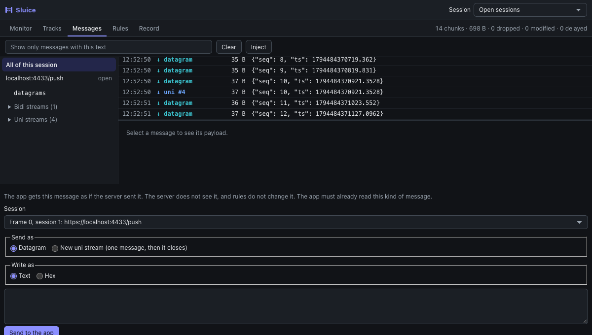

# Inject

**Inject** in the Messages view of the panel sends your app a message that the server did not send. Use it to test how the app handles a
message that is hard to get from a real server.

1. Start a WebTransport session on the page, and let the app start to read.
2. In **Messages**, click **Inject**. A form opens under the list. Choose the **Session**.
3. Choose **Datagram**, or **New uni stream** (one message, then the stream ends).
4. Write the payload as **Text** or **Hex**, and click **Send to the app**.

The line next to the button says if it is queued for the app. It does not say that the app read it. In **Messages**, the row has the word `injected`.

What to expect:

- **Only the app sees it.** The server does not, so its later replies can look wrong to the app.
- **Rules do not change it.** It also is not in the counters at the top of the panel.
- **The app must already read that kind of message on that session.** If not, the panel says so and nothing is sent. Sluice does
  not start to read for the app, as this could change how the app behaves.
- **Order holds.** A datagram waits behind data that is still delayed or held.
- **At most 64 KiB, and a limit on what waits.** An app that does not read has at most 1 MiB, or 64 new streams, waiting. A datagram
  can be larger than the real limit of the connection.
- **Not built:** a new bidi stream, and data in a stream that is already open.

