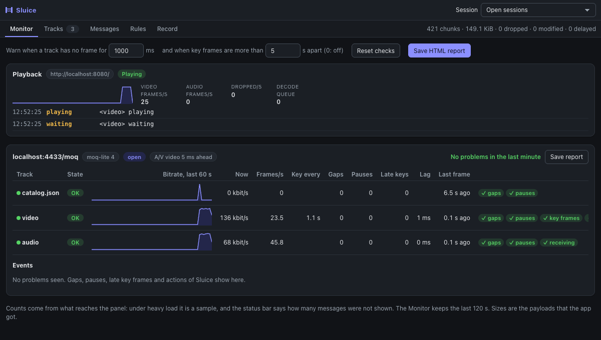
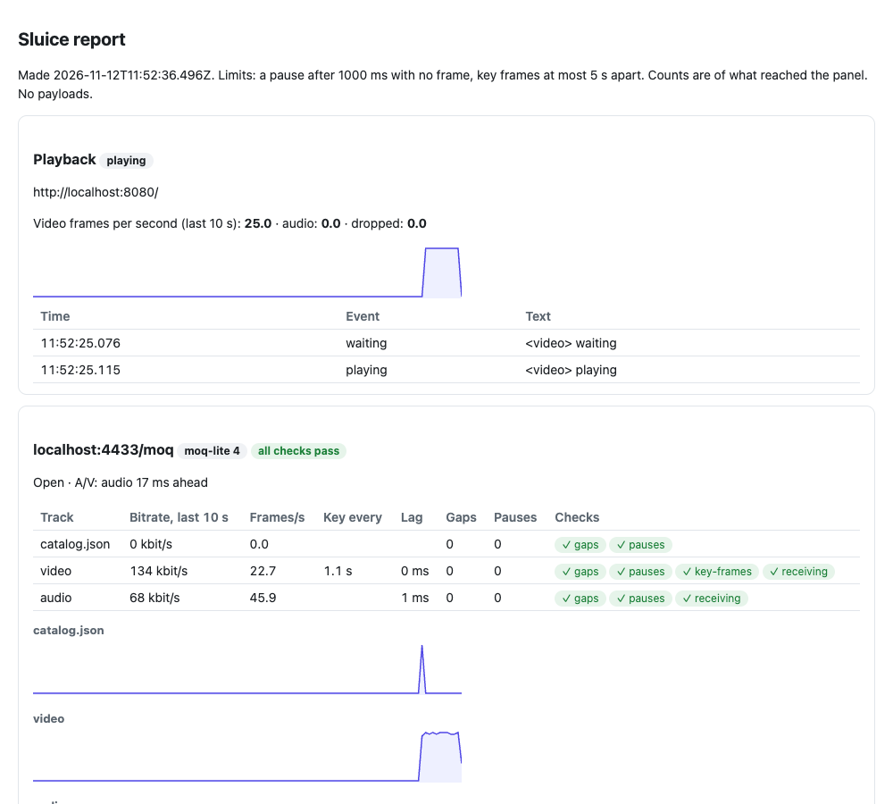
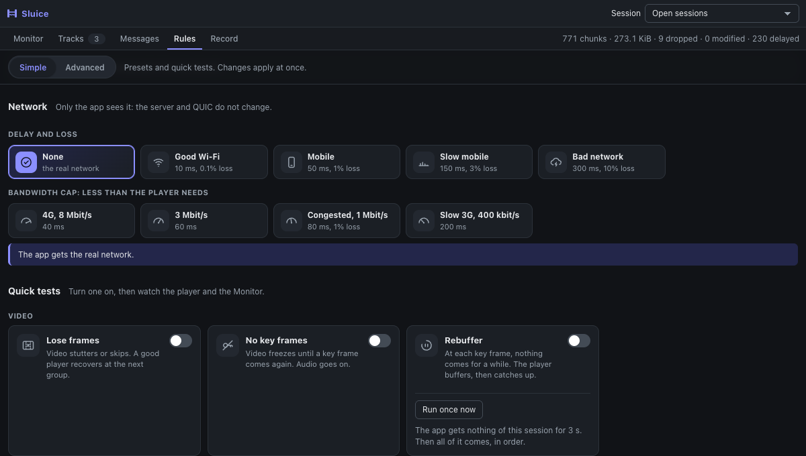

# Monitor

**Monitor** shows, for each MoQ track, what the app got in the last two minutes and the problems it saw. **Run once
now** in Rules changes a live session on purpose: stall it or close it. Use the two together: act, then watch what the player
does.



## Playback

At the top, **Playback** shows what the player showed, next to what the network gave:

- for a player that decodes with WebCodecs (most MoQ players): the frames that its `VideoDecoder`
  and `AudioDecoder` give back each second, their codec and size, the decode queue, and decoder errors;
- for a player with a `<video>`: the frames it showed and dropped, and its `waiting`, `stalled`, `playing` and error events.

The state is **Playing**, **Frozen** (video frames came, then none for 2 s) or **Waiting**. For example, with a bandwidth cap
lower than the stream, video frames per second drop here while the track rows show the pauses of the network. Counts only:
no frame leaves the page. A page sends them once it has a WebTransport session and the panel is open.

## Monitor

Open the **Monitor** tab and start the player. The **Session** picker in the top bar chooses which sessions show: by default
the open ones. Each session has a card with one row for each track:

| Column | What it says |
|---|---|
| State | **OK**, **Problem** (a problem in the last 10 s), **Stalled** (no frame for longer than the pause limit, while the session is open), **Not received** (quiet for 10 s while other tracks come: the player left it, for example for another quality; no `receiving` check) or **Waiting** |
| Bitrate, last 60 s | A chart of the bytes per second that the app got |
| Now | Bitrate of the last full second |
| Frames/s | Frames per second, over the last 4 full seconds |
| Key every | Mean time between key frames (video) |
| Gaps | Times a group was skipped: the app got group 7, then group 10 |
| Pauses | Times no frame came for longer than the pause limit |
| Late keys | Times two key frames were further apart than the key frame limit |
| Lag | How much later than its best of the last 30 s the last frame came, from the timestamps in the frames. A lag that grows means the track falls behind live |
| Last frame | How long ago the last frame came |
| Checks | Pass (✓) or fail (✗) for each check below. Point at one to see what was seen |

### Checks

| Check | Passes when |
|---|---|
| `gaps` | No group was skipped |
| `pauses` | No pause longer than the pause limit |
| `key-frames` | No key frame was dropped by a rule, none came late, and the last one is not older than the key frame limit. Only for tracks with key frames |
| `receiving` | Frames still arrive. Only for an open session |

The session header shows **A/V**: the media time of the last video frame minus the one of the last audio frame, such as
`audio 56 ms ahead`. Above 1 s it is marked: the player has to buffer the one ahead. Lag and A/V need timestamps in the frames:
moq-lite tracks with a timescale, or the older frame container with a timestamp before each frame (video and audio).

**Events** lists each problem with its time and track, newest first, and also what Sluice did (a stall, a reset, a close) and
when the session closed. For example:

```
13:36:56  gap         0.aac   group 181254 missing
13:36:46  stall               Sluice stalled the session for 3.0 s
```

A key frame that a rule drops is an event too, so the track shows **Problem**. A gap is often what the relay does on purpose: a player that cannot keep up gets newer groups, and older ones are skipped.

**Reset checks** starts counts, checks and events from zero, for example after you change a rule. **Clear** in Messages does
it too.

### Limits you can set

At the top: **Warn when a track has no frame for** (default 1000 ms) and **when key frames are more than** (default 5 s; 0 turns
it off). The pause limit is never less than 4 times the usual time between frames of a track, so a catalog that changes rarely
is not a problem. The limits are kept in this browser.

### Save HTML report

**Save HTML report** (at the top) gives one HTML file with Playback, each session with its tracks, checks, lag, A/V, bitrate
charts and events. It has no script, no outside resource and no payloads, and the URLs have no query, so you can attach it to a
ticket and anyone can open it.



### Save report

**Save report** gives a JSON file with the limits, `pass` (true when every check passed), each track with its checks, its
bitrate and frames per second over the last 10 s and its counts by second, and the events. It has no payloads, so
you can attach it to a bug report. The URL in it has no query.

## Stall or close once, by hand

In **Rules** > **Simple**, the quick tests **Rebuffer** and **Reconnect** have **Run once now**. It acts once on the newest open
session that the **Session** picker shows, and leaves the quick test off. The switch of a quick test runs it again and again.



| Run once now on | What the app sees | Does the server see it? |
|---|---|---|
| **Rebuffer** (the seconds of its slider, 3 s first) | Nothing more of this session for that time. Then everything that came comes, in order. Like a network that stops, then catches up. | No |
| **Reconnect** | The session closes (code 0), as after `WebTransport.close()`: `closed` resolves, and streams end. | Yes: a real close |

Each action shows in **Events** of the Monitor. To reset streams, use the rule action **Reset the stream**: it works on each
stream that matches (a track, a group), which a MoQ player opens and ends many times a second.

What to look for after an action:

- **Stall**: does the player show a spinner, keep playing from its buffer, then catch up or jump to live? With a large buffer,
  a short stall shows nothing.
- **Close session**: does the player reconnect, and how soon? The Monitor then shows the new session. The closed one is in the
  **Session** picker.

## The same from a rule, every time

The full editor (**Advanced**) has these actions with any value, and **Reset the stream**, so a test can run by itself and in CI. See [rules.md](rules.md#actions) and the recipes
[Rebuffer at key frames](recipes.md#10-make-the-player-rebuffer) and [Reconnect](recipes.md#11-test-reconnect).

## Checks in CI

The Playwright helper `openSluicePanel` opens the panel next to your page and reads the same report:

```ts
const sluice = await openSluicePanel(context, worker, page);
await startPlayer(page);
await page.waitForTimeout(5000);
const [report] = await sluice.report();
expect(report.pass).toBe(true);
```

See [`examples/playwright/checks.spec.ts`](../../examples/playwright/checks.spec.ts): with no rules the video track passes, and with
the scenario that drops key frames the `key-frames` check fails.

## Limits

- The Monitor counts what reaches the panel. Under heavy load that is a sample (at most 500 messages per second for each frame),
  and the status bar says how many messages were not shown.
- Times are when the network delivered a frame to Sluice, before rules. A stall or a delay of Sluice does not show as a pause.
- IETF drafts show a track by its name once its SUBSCRIBE went by (and SUBSCRIBE_OK, from draft 12). Before that, and for a track the server publishes on its own, they show `alias N`.
- A stall holds bytes in the page. A session stops reading from the network past `maxDelayedBytes` (8 MiB by default), and
  the server then slows down, as with a real slow network.
