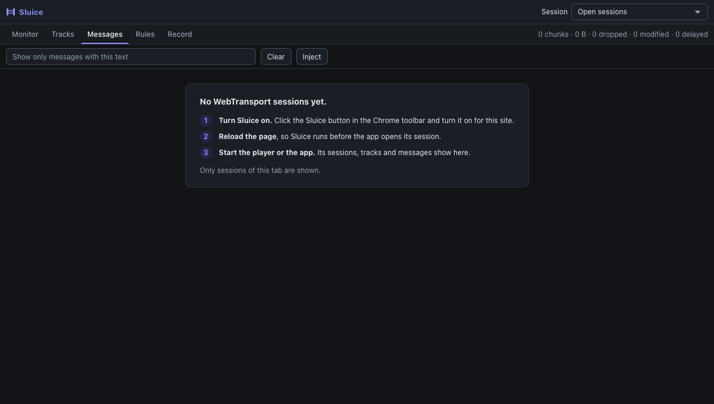
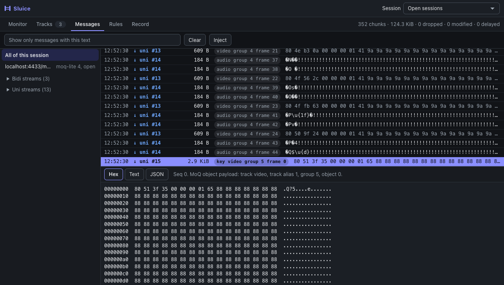
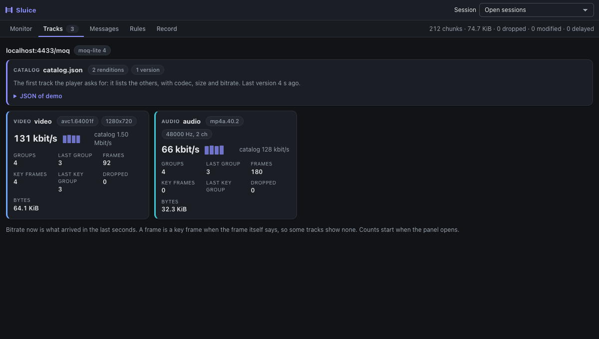

# The panel

The panel is the **Sluice** tab in Chrome DevTools. Turn Sluice on for the site first: see [turn-on.md](turn-on.md).

Open DevTools (`F12`, or `Cmd+Option+I` on macOS, `Ctrl+Shift+I` elsewhere), then click the **Sluice** tab.
The panel shows WebTransport sessions of the inspected tab only.

The panel has five views: **Monitor**, **Tracks**, **Messages**, **Rules** and **Record**. This guide is about the top bar, Tracks and Messages. For Monitor, see [monitor.md](monitor.md). For Rules, see [rules.md](rules.md). For Record, see [record.md](record.md).

## Before there are sessions

If the page has not opened a WebTransport session, the panel says **No WebTransport sessions yet.** and shows three
steps: turn Sluice on, reload the page, start the app. The first step has a check mark when Sluice is on for the site.

## The layout

- **Top bar.** It stays on every view: the name and the **Session** picker. **Start recording**, the time of a recording, the state of a replay (ready, replaying, ended) and **Stop playing** are at the top of the **Record** view; its tab shows a red dot while it records, and **ready** or **playing** while a replay waits or plays. The **Session** picker: **Open sessions** (the default: all open sessions, or all sessions when none is open, so a player that starts again leaves its old sessions out of view), **All sessions**, or one session. Tracks and Messages show only what the picker chooses. All lists of the panel open inside it, also near its edges. The panel fits its window at any width: it never scrolls sideways.
- **Toolbar.** The view tabs, and on the right a status and the counters (cut when the panel is narrow). The **Rules** tab shows the number of held messages.
- **Messages bar**, in Messages only: the filter box, **Clear** (empties the list) and **Inject** (it opens a form under the list to send the app a message as if the server sent it, see [inject.md](inject.md)).
- **Tracks** view. For moq-lite 3 to 6, one card for each track: codec, size and bitrate from the catalog, next to what
  arrived: bitrate now with a chart of the last seconds, groups, last group, frames, key frames, the last group with a key
  frame, dropped frames and bytes. The **catalog** card comes first: it is the first track the player asks for, as it lists the others, and it holds the catalog
  JSON. It comes once and again only when it changes, so it is never "not received". Then video, then audio. A track that got no frame for 5 s shows **not received
  now** and fades: the player took another quality, or stopped it. A track of the catalog that never came shows **not subscribed**. Rows in Messages
  also show `key` for a key frame. A rule can pick key frames with **MoQ frame type**.

  
- **Sidebar.** Sessions, with a state: `open`, `closed (code)` or `closed with error`. The sessions that the picker chooses. Open sessions come first. When a session is open, or when there are more than 3 closed ones, closed sessions are folded in **Closed sessions (N)**, newest first, with **Remove closed sessions**. **Show N closed sessions** shows the sessions that the picker hides. Under each session: `datagrams`
  (if there were any), then **Bidi streams** and **Uni streams** with a count, folded, newest first. `uni #N` is a one-way stream
  that the server opened, and `bidi #N` is a two-way stream. With MoQ, uni streams usually carry media, about one for each group of each
  track. `N` is a counter of Sluice across the page, not the QUIC stream ID. Click **All sessions**, a session, or a child to
  narrow the list.
- **Message list.** One row for each datagram or stream chunk: time, an arrow (`↓` the app got it, `↑` the app sent it),
  the kind in its color (datagram, uni, bidi), size, badges and a preview. A binary payload, such as a media frame, shows its
  first bytes in hex.
- **Detail.** The payload of the selected row.

Rows have a word as well as a color:

- `dropped`: a rule dropped it. The app did not get it.
- `modified`: a rule changed it.
- `+12 ms`: a rule delayed it by about that time.

A row shows what the **app got**. For a dropped chunk, it shows the original and the original size.

## Detail tabs

Select a row, then pick a tab: **Hex**, **Text** or **JSON**. Until you pick one, a binary payload opens in **Hex** and other
payloads in **Text**.

- **Hex** shows the bytes.
- **Text** decodes the bytes as UTF-8.
- **JSON** adds indent and line breaks, and keeps numbers and repeated keys as they came. If the payload is not valid
  JSON, it says so.

The note next to the tabs shows the sequence number (`Seq`). For a stream it adds "A chunk is not a message of the
app". For a long payload it says "First 4.0 KiB of 5.9 KiB": the panel keeps at most the first 4 KiB of each chunk.

Values from the page are always shown as text. A URL in a payload is never a link.

## Filter

Type in the filter box (**Show only messages with this text**). It is case-insensitive and plain text, not a regex. It matches:

- the kind (`datagram`, `uni`, `bidi`),
- the outcome (`passed`, `dropped`) and the word `modified`,
- the payload text of the shown preview.

The filter works together with the sidebar choice.

## Clear

The list keeps the last 5000 rows. `N older rows removed` counts the rows it let go. `N not shown` counts messages that never reached the panel, because too many came at once. The counters include both.

**Clear** empties the list and resets the counters. Open sessions stay in the sidebar. Closed sessions go away.
The list of workers that are not inspected stays (see [workers.md](workers.md)). Rule hit counts also stay, because
they belong to the Rules view.

## Counters and status

On the right: `chunks · size · dropped · modified · delayed`. They come from the page and count all traffic, also
rows that are not shown.

The list is a sample under load. At most 500 messages per second for each frame or worker reach the panel, and the
panel keeps the newest 5000.

The status also says **Not connected. Trying again.** when the panel lost its link to the service worker. It retries.

Traffic is sent to the panel only while the panel is open. With no panel, only session open and close events leave
the page, and no payload does.

## Keyboard

- `Tab` moves to the message list. It is a list box.
- In the list: `Up`, `Down`, `PageUp`, `PageDown`, `Home` and `End` select a row.
- In the **Hex / Text / JSON** tabs and in the view tabs (**Monitor / Tracks / Messages / Rules / Record**): `Left` and `Right` switch tab.

## Narrow panel

When the panel is at most 360 px wide, the sidebar goes above the list.

## Limits

- On streams, a chunk is not a message of the app. Chunk borders come from the network and the browser. With moq-lite 3
  to 6 and IETF drafts 7 to 23, a row is one whole frame or object instead (ADR-23, ADR-30).
- Counters come from the page, so a hostile page can report false numbers.
- The theme follows the DevTools theme.
