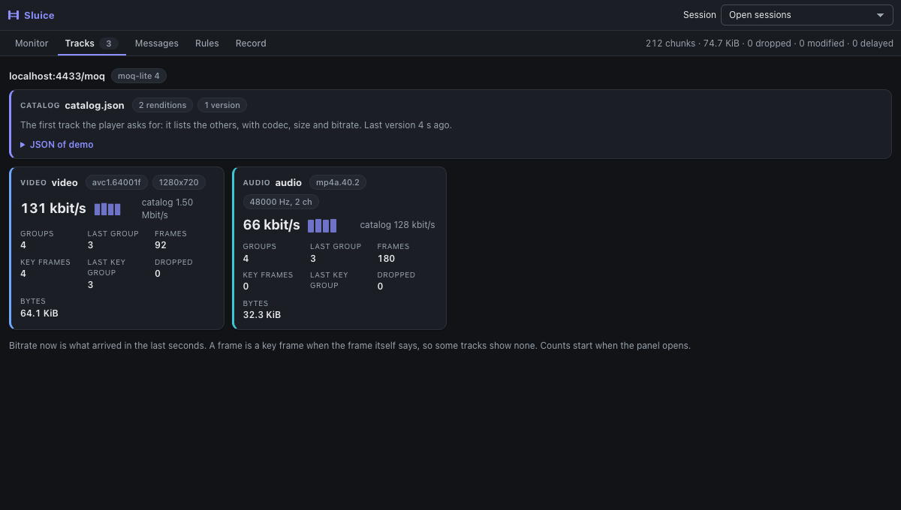
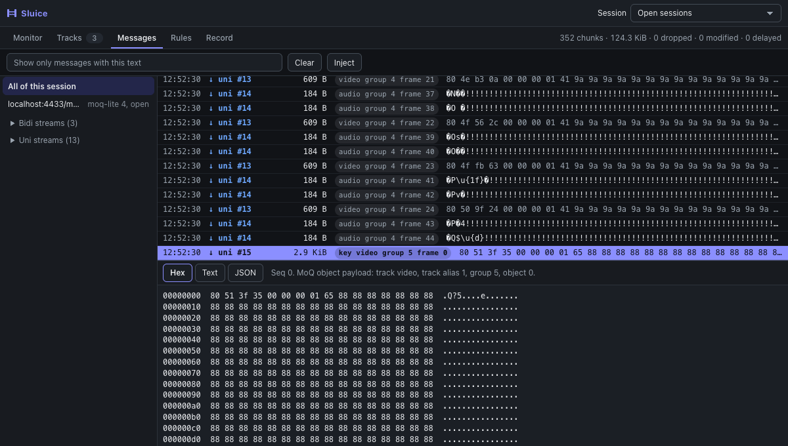
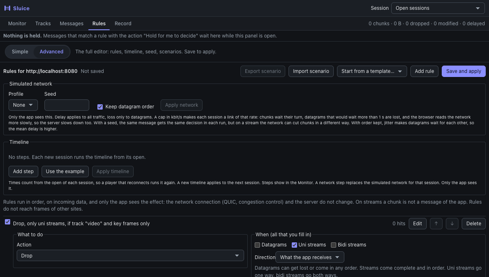
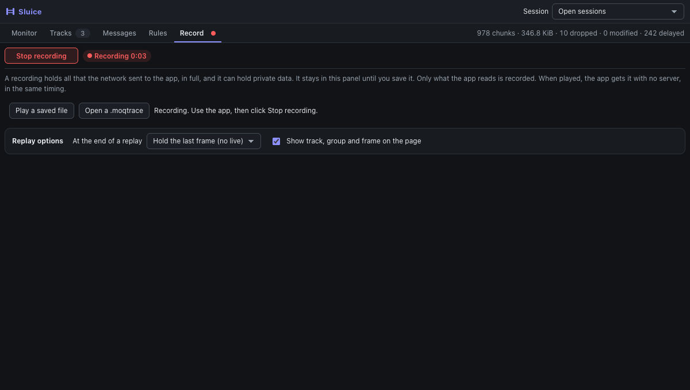
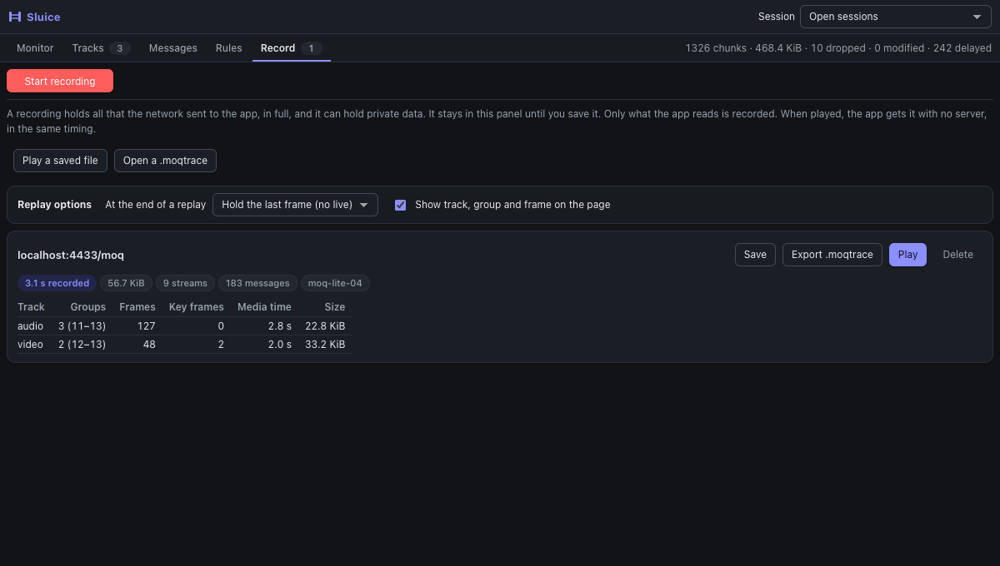
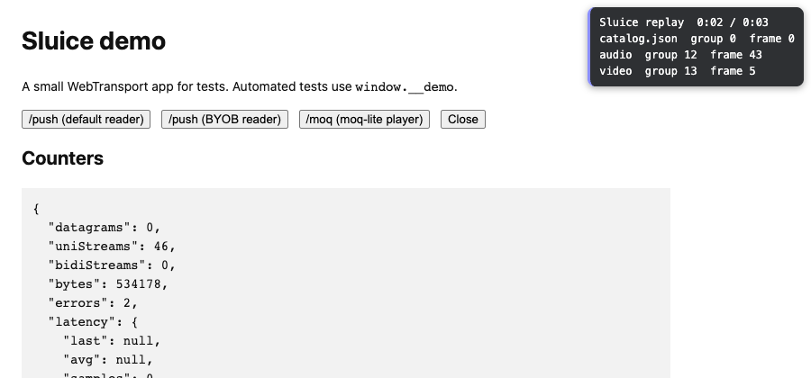
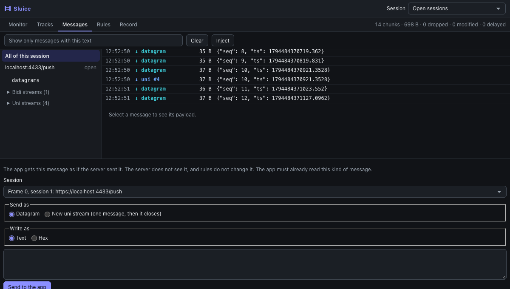
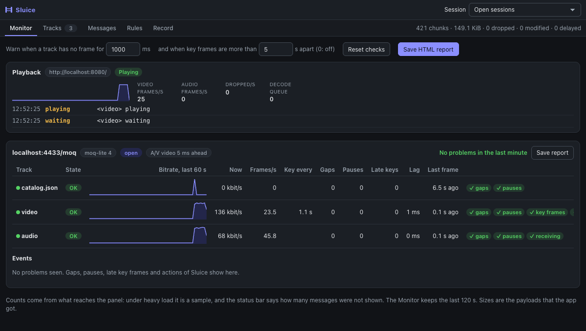
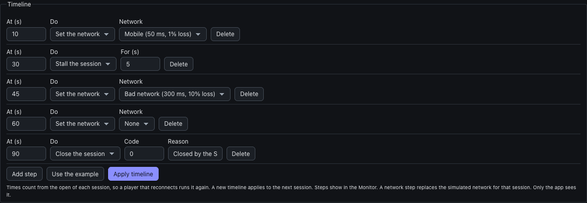

# Recipes: common tests, step by step

Each recipe says what to click, what to expect, and the same setup as a scenario file. A scenario file holds the rules and the
simulated network of a site. To load one: **Rules** > **Import scenario**. The files are in
[`examples/scenarios`](../../examples/scenarios), and a unit test checks that they stay valid.

Before you start: turn Sluice on for the site, reload the page, and open the **Sluice** tab in DevTools
([turn-on.md](turn-on.md)).

Track names in these recipes (`video`, `audio`, `catalog.json`) are the ones of the local demo. Your player can use other names:
**Tracks** shows them. For example, a moq-lite broadcast can call its tracks `2.avc3` and `0.aac`.

## 1. See what a MoQ player gets

1. Open **Tracks**, then start the player.
2. Each track has a card: codec and size from the catalog, bitrate now (with a small chart of the last seconds), groups,
   frames, key frames, the last group and the last group with a key frame.



What to look for:

- **Bitrate now** far from **catalog**: the encoder or the relay does not send what the catalog says.
- **Key frames** equal to **Groups** on video: each group starts with a key frame, as it should.
- **Last group** that stops growing: the track stalled.

Open **Messages** to see each frame: `key video group 4 frame 0` is the key frame that opens group 4. A media frame shows in hex.



## 2. Lose the key frames of a track

Test: what does the player do when a group has no key frame? It should skip to the next group, not freeze.

1. **Rules** > **Simple** > turn on **No key frames** (or, in **Advanced**, **Start from a template…** > **MoQ: drop every key frame
   of a track**).
2. In the form, set **Track** to your video track (for example `2.avc3`).
3. Click **Save and apply**. The rule works at once, with no reload.



Scenario file: [`moq-keyframe-loss.json`](../../examples/scenarios/moq-keyframe-loss.json). The rule in it:

```json
{
  "id": "drop-video-key-frames",
  "action": { "type": "drop" },
  "on": ["uni"],
  "match": { "moqt": { "track": "video", "keyframe": true } }
}
```

Expect: video stops or freezes, audio goes on. The hits on the rule count the dropped key frames. Delete the rule (or untick
it) and save, and video should come back at the next group.

## 3. Lose some frames

Test: a lossy relay. **Start from a template…** > **MoQ: lose 10% of the frames of a track**.

```json
{
  "id": "lose-10-percent-of-video",
  "action": { "type": "drop" },
  "on": ["uni"],
  "match": { "moqt": { "track": "video" } },
  "probability": 0.1
}
```

File: [`moq-frame-loss.json`](../../examples/scenarios/moq-frame-loss.json). It has `"seed": 42`, so the same frames are lost in
each run.

## 4. Make audio late (A/V sync)

Test: does the player keep audio and video in sync, or report the drift?
**Start from a template…** > **MoQ: delay a track by 500 ms**, with **Track** set to your audio track.

```json
{
  "id": "audio-500-ms-late",
  "action": { "type": "delay", "delayMs": 500 },
  "on": ["uni"],
  "match": { "moqt": { "track": "audio" } }
}
```

File: [`moq-audio-late.json`](../../examples/scenarios/moq-audio-late.json). Rows of delayed frames show `+500 ms`.

## 5. Change the catalog by hand

Test: what does the player do with another codec, size or bitrate in the catalog?

1. **Start from a template…** > **MoQ: hold the catalog, to edit it by hand**. Save.
2. Start the player. The catalog waits at the top of **Rules**, and the tab shows `1 held`.
3. Click **Edit**, change the JSON (for example `"codedWidth": 1280` to `640`), then **Forward edited**.

If you do nothing for 30 s, the catalog goes on as it was (`"onTimeout": "forward"`).
File: [`moq-edit-catalog.json`](../../examples/scenarios/moq-edit-catalog.json).

## 6. Use a mobile network

**Rules** > **Simulated network** > **Profile**: **Mobile (50 ms, 1% loss)**, then **Apply network**. All traffic gets
50 ms ± 20 ms of delay, and 1% of datagrams are lost. Streams are never lost: QUIC sends them again.

```json
"datagram": { "dropRate": 0.01, "delayMs": 50, "jitterMs": 20, "preserveOrder": true },
"stream": { "delayMs": 50, "jitterMs": 20 }
```

File: [`mobile-network.json`](../../examples/scenarios/mobile-network.json). Only the app sees this network: the server and QUIC
do not change.

## 7. Record a problem and play it again, with no server

1. Start the player. When it shows the problem, click **Start recording** at the top of **Record**. The timer counts.

   

2. Click **Stop recording**. The **Record** tab shows what it holds: time, size, and for each track the groups, frames and
   key frames.

   

3. Choose what happens at the end: **Hold the last frame** (the default), **Play it again**, or **Go live**.
4. Click **Play**, then start the player again in the page (for example a new session), with no reload. It gets the
   recording, with no server. A box on the page shows the time and the last group and frame of each track.

   

5. Click **Stop playing** at the top of **Record** to go live again.

**Save** gives a file that you can attach to a bug report. Another person plays it with **Play a saved file**. The file holds
everything the app got: treat it as private. The URL in it has no query, so a `?jwt=` token is not saved.

## 8. Send the app a message

**Messages** > **Inject** opens a form under the list. Choose the session, a datagram or a new uni stream, and the payload as
text or hex. See [inject.md](inject.md).



## 9. Watch the health of the player

Open **Monitor**. Each track has a state (**OK**, **Problem**, **Stalled**), a bitrate chart of the last minute, frames per
second, the time between key frames, and counts of gaps, pauses and late key frames. **Events** lists each problem with its
time. **Save report** gives a JSON file for a bug report. See [monitor.md](monitor.md).



## 10. Make the player rebuffer

Test: does the player show a spinner and recover when the network stops for a moment?

- Once, by hand: **Rules** > **Simple** > **Rebuffer** > **Run once now**.
- Again and again: **Start from a template…** > **MoQ: stall the session for 3 s at each key frame**.

```json
{
  "id": "stall-3-s-at-key-frames",
  "action": { "type": "stall", "durationMs": 3000 },
  "on": ["uni"],
  "match": { "moqt": { "track": "video", "keyframe": true } }
}
```

File: [`moq-rebuffer.json`](../../examples/scenarios/moq-rebuffer.json). After a stall ends, the next key frame starts the next
one. Watch **Last frame** and the player: a player with a large buffer keeps playing through a short stall.

## 11. Test reconnect

Test: does the player reconnect after the session closes, and how soon?

- Once, by hand: **Rules** > **Simple** > **Reconnect** > **Run once now**.
- Now and then: **Start from a template…** > **MoQ: close the session now and then (1% of video frames)**. At 25 frames per
  second this closes about every 4 s.

```json
{
  "id": "close-at-a-video-frame",
  "action": { "type": "close-session", "closeCode": 0, "reason": "Closed by Sluice" },
  "on": ["uni"],
  "match": { "moqt": { "track": "video" } },
  "probability": 0.01
}
```

File: [`moq-reconnect.json`](../../examples/scenarios/moq-reconnect.json). The close reaches the server. **Events** in the
Monitor shows the close, and the **Session** picker shows the new session.

To test a broken group instead: the rule action **Reset the stream**, with a track and a group.

## 12. Cap the bandwidth (ABR)

Test: does the player pick a lower quality, or skip, when the link is slower than the stream?
**Rules** > **Simulated network** > **Profile**: **Slow 3G, 400 kbit/s (200 ms)**, then **Apply network**. Other caps: 1, 3 and
8 Mbit/s.

```json
"bandwidth": { "kbps": 400, "queueMs": 1000 }
```

Each session becomes a link of that rate: chunks wait their turn, datagrams that would wait more than `queueMs` are lost, and
the browser reads the network more slowly, so the server slows down too. For example, a 1.2 Mbit/s stream under a cap of 400 kbit/s
can drop to a few frames per second, then stall, and the Monitor shows **Stalled** and pauses. With the cap gone, a good player
skips the late groups and comes back to full speed. In a timeline, network steps with caps make a
curve: for example 8 Mbit/s, then 1 Mbit/s at 20 s, then 8 Mbit/s at 40 s.

## 13. Play a story in time (timeline)

Test: how does the player live through a bad minute? **Rules** > **Timeline** > **Use the example**, then **Apply timeline**:

| At | Step |
|---|---|
| 10 s | Mobile network (50 ms, 1% loss) |
| 30 s | Stall for 5 s |
| 45 s | Bad network (300 ms, 10% loss) |
| 60 s | Network back to none |
| 90 s | Close the session |

Times count from the open of each session, so a player that reconnects plays it again. Each step shows in **Events** of the
Monitor. File: [`network-story.json`](../../examples/scenarios/network-story.json):

```json
"timeline": [
  { "atMs": 10000, "action": { "type": "network", "dropRate": 0.01, "delayMs": 50, "jitterMs": 20 } },
  { "atMs": 30000, "action": { "type": "stall", "durationMs": 5000 } },
  { "atMs": 90000, "action": { "type": "close-session", "closeCode": 0, "reason": "Closed by the Sluice timeline" } }
]
```



## 14. Run a scenario in CI

Load a scenario file in a Playwright test, so the same rules and network run in each build, and read the checks of the
Monitor to pass or fail the build:

```ts
await applyScenario(worker, 'https://app.example.com', 'examples/scenarios/moq-frame-loss.json');
const page = await context.newPage();
await page.goto('https://app.example.com/player');
const sluice = await openSluicePanel(context, worker, page);
// ... start the player, wait a few seconds ...
const [report] = await sluice.report();
expect(report.tracks.find((t) => t.name === 'video')?.checks.find((c) => c.id === 'receiving')?.pass).toBe(true);
```

See [`examples/playwright`](../../examples/playwright/README.md).
