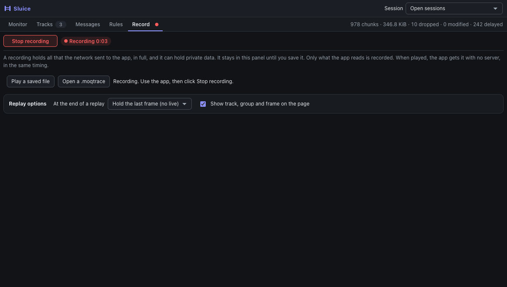
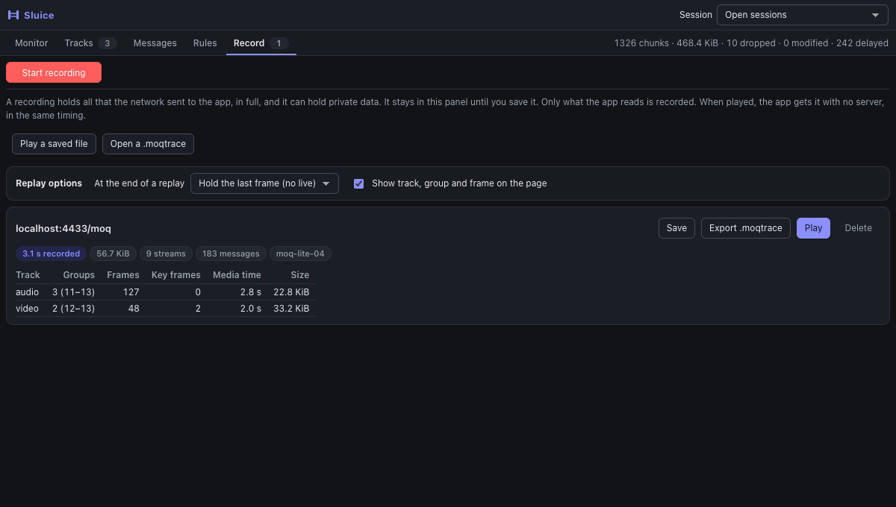
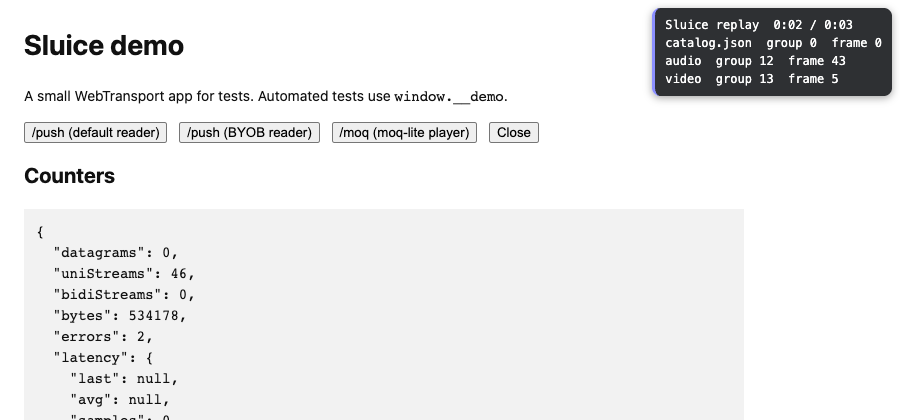

# Record and replay

Sluice saves what the network sends to your app, and plays it again with no server.

1. Open **Record** and click **Start recording** at the top. The tab shows a red dot while it records, also on other views. The timer counts. Use the app. Click **Stop recording**.

   

2. The **Record** tab shows that the recording is on its way, then each session gets a card with what it holds. **Save** gives
   you a JSON file.

   

3. Choose what happens at the end, in **Replay options**.
4. Click **Play** on a card, or **Play a saved file**. Nothing plays yet. Start a new session in your app, with no reload: the
   next session to the same place (origin and path, whatever its query) plays it.
5. Click **Stop playing** at the top of **Record** to end the replay. The app can then go live.

## Export a `.moqtrace` file

**Export .moqtrace** on a recording writes it in the `.moqtrace` format (version 2), an open trace format that other MoQ tools
read. Use **Save** for a file that plays in Sluice: an export does not play.

The file holds, in time order:

- the control messages, with the fields that Sluice reads (track names and aliases of SUBSCRIBE and SUBSCRIBE_OK) and their
  bytes;
- each stream and datagram, with its track alias and group;
- each object, with its whole payload;
- the end of each stream, and the close of the session.

What to expect:

- **Only MoQ.** The button shows for IETF MoQT drafts 7 to 23 and moq-lite 3 to 6. moq-lite subscribe streams are written as
  control messages of type 2, with the same fields as SUBSCRIBE.
- **The URL keeps only host and port.** The path and the query can hold a token, so they are not in the file.
- **What the app wrote:** a recording keeps the first 512 bytes of each stream that the app opened. Later control messages that
  the app wrote are not in the file. All that the server sent is.
- **Times** are whole milliseconds from the start of the session. Recordings made before this version have no start time: the
  file then takes the time of the export.
- A file holds the payloads, so it can hold **private data**, as the recording does.

## Open a `.moqtrace` file

**Open a .moqtrace** reads a trace in the `.moqtrace` format (version 1 or 2) and shows it as a closed session: **Monitor** with its
tracks and events, **Tracks**, and **Messages** with each control message as JSON and each object. Track names come from
SUBSCRIBE and SUBSCRIBE_OK in the file, when the file has them as fields. It does not play: a `.moqtrace` keeps decoded fields,
not the bytes of each stream. **Clear** removes it, as it removes closed sessions.

What to expect:

- **At the end of a replay** the app holds its last frame (the top of **Record** says **Replay ended: the app shows the last frame**) and does not go live, until you click **Stop playing**. If you start the player again, the recording plays again from the start. Choose **Play it again** or **Go live** before Play to change this.
- **A box on the page** shows the time and the last track, group and frame. There is only one box, also when the player starts again. Turn it off before Play if you do not want it.
- **Media starts at the first whole group** after Start recording, so up to one group is not in the recording.
- **No server is used.** The app gets the same messages in the same timing, and what it writes goes nowhere. So the messages do not change
  with what the app sends.
- **Rules still apply**, as in a live session. They do not change the recording, which has the data from before the rules.
- **One card for each recording.** If the player opened more than one session while you recorded (for example after a
  reconnect), the card shows each one as a part, and each part plays on its own. A part with no video key frame says that it
  plays audio only. A session that plays a recording is never recorded.
- **Each recording says what it holds:** the time from Start to Stop, the size, the streams and datagrams. For a MoQ session it also shows each track: groups (first to last), frames, key frames, media time and size.
- **Start recording stops a replay** that waits or plays, so the next session goes to the real server.
- **You can start recording at any time.** The recording also holds the first 2 MiB of each open session, as an app needs its start to play. It then jumps to the moment you started.
- **Only what the app read is in it**, up to 32 MiB in a page. Past that, the row says "Not complete".
- **A failed connection to `127.0.0.1:9` in the console is normal** during a replay: this is how Sluice keeps the real server out. The token of the app is not needed.
- **Click Play first, then start the session.** A session that is already starting stays live. A reload loses what is armed, so a session
  that starts at page load does not play.
- **Delete** removes a recording from the panel. If it waits or plays, the replay stops, and the next session of the app is live. Saved files stay on your disk.
- **Workers:** their sessions are recorded, and they do not play.
- **Each request gets its own answer.** A recording keeps the first bytes that the app wrote on each stream it opened. In a replay, a stream of the app gets the recorded stream that answers the same request (for moq-lite: the same broadcast and track), in any order. moq-lite subscribe IDs are changed to the ones the app uses now. If the app asks again for a track, it gets the same answer again, and the new groups go to the newest request. A track that is not in the recording (another quality) gets the recorded track of the same kind, for example `.avc3` or `.aac`. A request with nothing of its kind gets no answer, and its stream stays open. Older recordings play in the order of opening.
- **The query of the URL is not kept**, so a token there is not in the file.
- **The file holds full payloads.** Treat it as private. It stays in the panel until you save it, and it goes when the panel closes.
