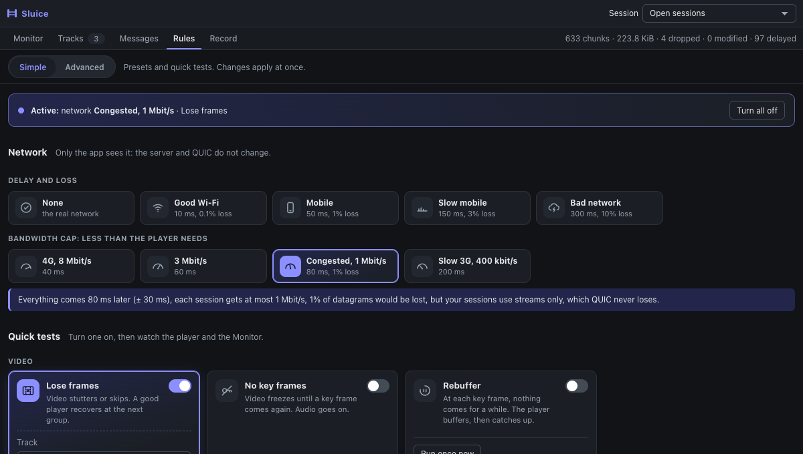
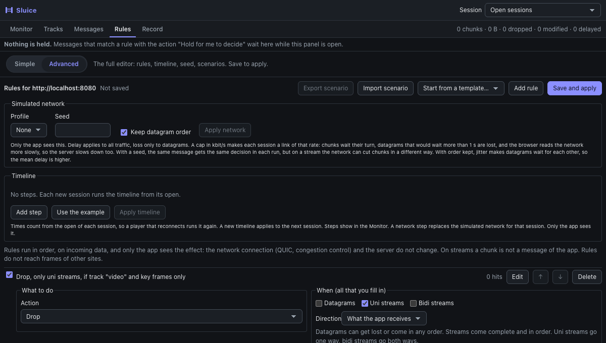
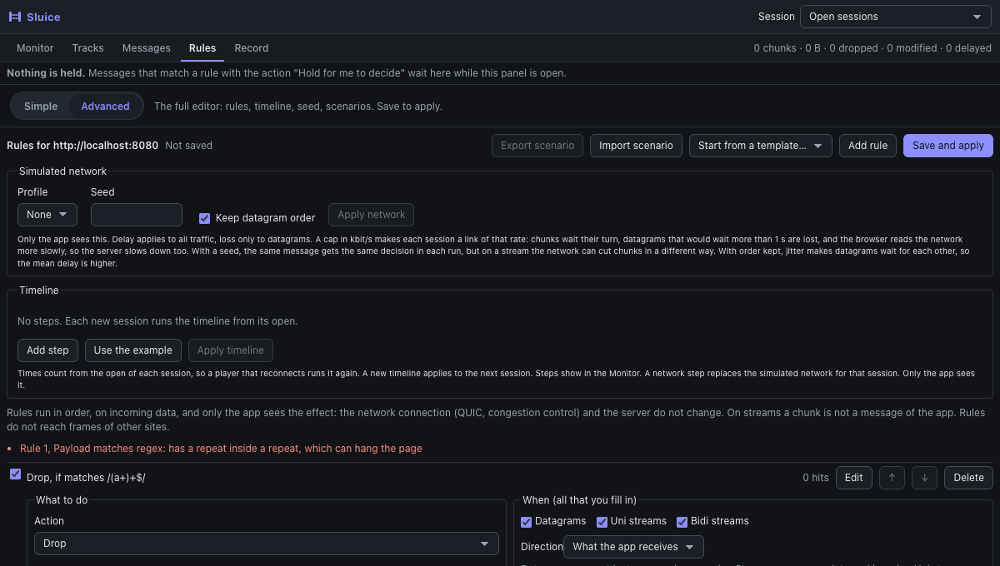

# Rules

Rules let you drop, delay, change, log or hold traffic of your app. You write them in a form in the panel, or start
from a template. For ready tests, see [recipes.md](recipes.md).
Open DevTools, click the **Sluice** tab, then the **Rules** view.

Rules are plain JSON data. Sluice never runs them as code (no `eval`, no `new Function`).

## Simple and Advanced

The Rules view opens in **Simple**. Switch to **Advanced** at the top for the full editor; the choice is kept.

**Simple** has four parts, and every change applies at once:

- **Active**: one line that says what runs now (network, tests, your rules, a timeline), with **Turn all off**. That removes the
  quick tests, turns your rules off (they stay), removes the timeline and sets the network to None.
- **Network**: click a profile. *Delay and loss* profiles add latency (and lose datagrams); *Bandwidth cap* profiles give the
  player less than it needs, which is what makes a player struggle. A line under them says what the profile does to your
  sessions: for example, a MoQ player on streams loses nothing, as QUIC streams are reliable, and a buffer can hide a small
  delay.
- **Quick tests**, in groups (Video, Audio and sync, Connection, Content): each card says what the player should do. Turn it on,
  and its track (the tracks your player gets, already chosen), its slider and a live count of matches appear. A test that needs a
  track stays off until the player runs, so it never acts on every stream by mistake. *Lose frames*, *No key frames*, *Late track*, *Missing track*, *Rebuffer*,
  *Reconnect*, *Edit the catalog*, *Lose datagrams*. **Rebuffer** and **Reconnect** also have **Run once now**: one stall or
  one close of the newest open session, now, with the quick test left off ([monitor.md](monitor.md)).
- **Your rules**: the rules you made in Advanced, each with a switch to turn it off and keep it, its hits, and **Delete**.

**Advanced** is the editor below: rules with every field, the simulated network with a seed, the timeline, and scenario files.
Quick tests are rules too (their ids start with `quick-`), so Advanced shows and edits them.

## What a rule can touch

- **What the app receives, by default.** **Direction** can also pick what the app sends, or both (ADR-29).
- **Only the app sees the effect.** The network, QUIC, congestion control and the server do not change. A dropped
  datagram was still sent by the server and received by the browser. Only your app does not get it.
- **A chunk is not a message.** On streams, rules see chunks as the browser delivers them, not the messages of your
  protocol. A text you look for can be split across two chunks. With moq-lite 3 to 6 and IETF drafts 7 to 23, rules with
  MoQ fields see whole frames or objects instead.
- **Same site only.** Rules reach the frames of the site in the tab. Frames of other sites get no rules.

## Timeline

**Timeline** (under Simulated network) holds steps in time, from the open of each session: **Set the network** (a profile),
**Stall the session** (seconds) or **Close the session** (code and reason). **Use the example** fills a story of 90 s.
**Apply timeline** saves it for the site, apart from the rules. It applies to the next session. A network step replaces the
simulated network for that session, and only the app sees it. At most 64 steps, up to 24 hours. See
[recipes.md](recipes.md#13-play-a-story-in-time-timeline).

## Start from a template

**Start from a template…** adds a ready rule and opens it in the form, so you see every field and can change it. A template
uses the real track names of your player: `video` and `audio` become the first video and audio track that the player gets now
(for example `2.avc3` and `0.aac`). The rule works only after **Save and apply**; the row then counts its hits.

If a rule names a track that the player does not get, its row says so in red, with the tracks it gets. The **MoQ track name**
field offers those names as you type.

| Template | Rule |
|---|---|
| MoQ: drop every key frame of a track | Drop, uni streams, track `video`, key frames only |
| MoQ: lose 10% of the frames of a track | Drop, uni streams, track `video`, 10% of the time |
| MoQ: delay a track by 500 ms | Delay 500 ms, uni streams, track `audio` |
| MoQ: drop all frames of a track (a missing track) | Drop, uni streams, track `audio` |
| MoQ: hold the catalog, to edit it by hand | Hold 30 s then forward, track `catalog.json` |
| Lose 5% of datagrams | Drop, datagrams, 5% of the time |
| Log what the app sends | Log, direction: what the app sends |
| Replace a text in the payload | Replace `old` with `new` |
| MoQ: stall the session for 3 s at each key frame | Stall 3 s, uni streams, track `video`, key frames only |
| MoQ: close the session now and then (1% of video frames) | Close, uni streams, track `video`, 1% of the time |

## Add a rule

1. Click **Add rule**. A new rule opens. Its default action is **Drop**, for all traffic kinds.
2. Pick the **Action** (left group, "What to do").
3. Fill the **When** conditions (right group). Leave a field empty to ignore it.
4. Click **Save and apply**. The rules close to one line each; **Edit** opens one again.

Each rule has a row with a short sentence, such as `Drop, if contains "hello"`. The row also has:

- a check box to turn the rule on or off (the rule stays in the list),
- the number of hits since the page loaded,
- **Edit**, the up and down arrows, and **Delete**.

## Actions

| Action | What it does | Fields |
|---|---|---|
| Drop | The app never gets the chunk. | none |
| Delay | The app gets the chunk later. | Delay in ms, and Jitter in ms. |
| Replace text | Replaces every match of the **Find** text in the payload. | Find, Replace with. |
| Set payload | Replaces the whole payload with new text. | New payload. |
| Log to the page console | Prints the payload in the console of the page. Scripts of the page may read it. | none |
| Hold for me to decide | The message waits at the top of Rules until you forward, edit or drop it. | Wait at most, If time runs out. |
| Stall the session | From the first match, the app gets nothing of this session for that time, this message too. Then all of it comes, in order. A match during a stall does not make it longer. | Stall for (seconds), up to 120. |
| Close the session | Closes the whole session at the match, as `WebTransport.close()` does. The server sees it. The message is dropped. | Close code, Reason. |
| Reset the stream | The stream of the message ends with an error for the app (`streamErrorCode`), and the server stream is stopped. Nothing happens to datagrams. | Error code, 0 to 255. |

Notes:

- **Delay.** The longest delay is 3,600,000 ms (one hour). Jitter adds or removes up to that many ms at random.
  Chunks keep their order, so a chunk waits for the one before it. With many chunks per second, the delays get
  close to delay + jitter, and they vary less. For example, 100 ms with 50 ms jitter on datagrams gave a mean of
  107 ms at 20 per second, and 138 ms at 700 per second. A delay with no jitter is exact.
- **Delay limits throughput.** All delayed bytes of one session wait in memory, up to 8 MiB. When that is full,
  Sluice stops reading the stream. So a long delay limits the speed of a session to about
  `(8 MiB + one chunk for each stream) / delay`. With a 10 s delay, that is about 6.7 Mbit/s.
- **Modify.** A payload that grows past 16 MiB is not changed (the rule is skipped). A payload that becomes empty
  counts as a drop, because an empty chunk cannot be delivered.
- **Log.** The panel list already shows traffic, so use Log when you also want lines in the page console.

## When (conditions)

A rule applies only if **all** the fields you fill in are true. With no field, it applies to every message.

| Field | Meaning |
|---|---|
| Datagrams, Uni streams, Bidi streams | Which kinds of traffic. At least one must stay on. |
| Direction | What the app receives (the default), what it sends, or both. |
| Payload contains | The payload has this text (UTF-8). The form takes one text. |
| Payload starts with | The payload begins with this text. |
| Payload matches regex | The first 4 KiB, decoded as text, matches. Tick **Ignore case in the regex** for `i`. |
| Min size, Max size | Size in bytes. |
| Session URL contains | The URL of the session has this text. |
| MoQT track alias, group from and to, subgroup, object from and to | Fields of a MoQT object, on a session with a draft from 7 to 23. See [MoQT objects](#moqt-objects). |
| Only this % of the time | A number from 0 to 100. Chosen at random for each chunk that matches the other conditions. |
| If this rule matches, skip the rules after it | The rules below it are not checked. |

Uni streams go one way (server to client, for data you receive). Bidi streams go both ways. Datagrams can get lost
or arrive in any order, and streams arrive complete and in order.

## Order

Rules run from top to bottom. Use the arrows to move a rule.

- **Drop** ends the checks at once. The chunk is gone.
- **Delay** adds up: two matching delay rules add their times.
- **Modify** rules chain. The second sees the output of the first, so "A then B" can give another result than
  "B then A".
- **If this rule matches, skip the rules after it** stops the checks after a rule that matched.

## Errors

If a field is not valid, the form shows a message next to the field, names the rule, and saves nothing. The rule
with the error opens by itself.

Fix it and click **Save and apply** again.

If a rule fails while it runs, Sluice skips it and the traffic of your app goes on. The first failure is logged once
in the page console.

## Saving

The state next to the title says **Saved**, **Not saved**, **Saving** or **Not connected**. A save is done only when the
service worker confirms it.

- Rules are saved **for each site**, by origin: scheme, host and port. `http://localhost:8080` and
  `http://127.0.0.1:8080` have different rules. The panel title says which site you edit.
- They are kept in `chrome.storage.local`, in plain text, in your browser profile. A site can save about 2 MB of
  rules, and at most 256 rules.
- A saved rule is applied to the page from its first chunk. The first read of a stream waits up to 500 ms for the
  saved rules. If they come later, chunks pass with no rules until they arrive.
- Edits that you did not save stay when you look at **Messages** and come back. They are marked **Not saved**.
- You can save rules for a site where Sluice is off, to prepare them. The Rules view says Sluice is off and how to
  turn it on.

A rule whose regex was slow is turned off for that page, and its row says **turned off: too slow**.

### Delete rules

- In the panel: use **Delete** on each rule, then **Save and apply**.
- In the popup: **Delete rules of this site**. See [turn-on.md](turn-on.md).

A page that is open keeps deleted rules until it reloads (ADR-15).

## Limits

- **Regex can hang the page.** A regex runs on the main thread of the page, and JavaScript cannot stop it. The form
  refuses the common bad shape `(a+)+`, but not all of them, such as `(a|aa)+`. After one test over 50 ms the regex is
  turned off for that page. If a page hangs, use the popup (see [turn-on.md](turn-on.md)). With a payload over 4 KiB,
  a regex with `$` does not match.
- **Rules that the form cannot edit.** A rule with more than one text pattern or more than one edit is kept as it is.
  Its row says "cannot be edited here".
- **Limits of size.** Regex up to 1024 characters, session URL up to 8192.
- **Random decisions change in each run**, unless you set a seed. See [Simulated network and seed](#simulated-network-and-seed).

## Try it with the demo

With the [test environment](../../README.md#try-it-with-no-app-of-your-own) running, open the demo page, then add a rule:

- Action **Replace text**, Find `seq`, Replace with `SEQ`, only **Datagrams**.
- Click **Save and apply**, press **Close**, then **/push (default reader)** on the demo page.

The datagram rows show `modified`, and the Text tab shows `{"SEQ": 0, "ts": ...}`.

## MoQT objects

If a session uses an IETF MoQT draft from 7 to 23, the sidebar shows it, for example `MoQT draft 16`. With other drafts it shows `chunks only`, and rules with MoQT fields never match there. moq-lite is not an IETF draft: versions 3 to 6 show as, for example, `moq-lite 6`, with track names, groups and frames. Other versions stay in chunks. **MoQ track name** works on moq-lite and on IETF drafts (see the limits below). A session on `moql` (moq-lite with its version
in the setup) shows `moq-lite (version in its setup), chunks only`.

While a rule with a MoQT field is on, each new stream of such a session is cut into objects, and object datagrams are read too:

- **All rules** see the payload of each object as the message. The rows show the group and the object.
- **Drop** removes the whole object. Sluice corrects the ID of the next object and the stream header, so the app reads right IDs.
- **Set payload, Replace text, Hold** change the payload, and Sluice writes the new length. An empty payload counts as a drop.
- Object status messages and stream headers skip the rules.

Limits:

- A stream keeps its mode from its first chunk, so a new rule applies from the next stream. Datagrams follow it at once.
- An object waits until it is complete, up to 16 MiB, so large objects come later. Above that, the stream goes back to chunks.
- **MoQ track name** works once the app subscribed to the track: Sluice reads SUBSCRIBE and SUBSCRIBE_OK (ADR-45). A track that
  the server publishes on its own (PUBLISH) has only its alias. Track names were checked with test vectors of drafts 7 to 23,
  and with a real server on draft 22.
- Fetch streams stay in chunks.
- If you drop the last object of a stream that has the END_OF_GROUP bit, the app takes the object before it as the end of the group.
- Each draft was checked with MIT test vectors (see `THIRD_PARTY_NOTICES.md`). Only draft 22 streams were tested with a real
  server. Object datagrams were not.
- A draft from 15 needs the server to name the protocol, or the page to offer only one MoQT draft. If not, there is no label.

## Simulated network and seed

**Simulated network**, at the top of the Rules view, has a profile, a seed and **Keep datagram order**. Click **Apply network**. These settings are saved apart from the rules.

- **Profile** adds delay and jitter to all traffic, and loss to datagrams. Values are simple numbers for tests, not measurements of a real network.
- **Seed** is a whole number from 0 to 4294967295. With a seed, the same message gets the same loss, delay and chance in each run. Leave it empty for new random numbers.
- **Keep datagram order** is on by default. With it on, jitter makes datagrams wait for each other, so the mean delay is above the profile value. Turn it off to let them arrive out of order.

A seed repeats decisions, not exact times. See the limits in [the Playwright example](../../examples/playwright/README.md#what-a-seed-repeats).

## Scenarios

A scenario is a JSON file with all settings of a site: rules, simulated network and seed.

- **Export scenario** saves what is saved for the site. Save your rule edits first.
- **Import scenario** replaces all rules and network settings of the site. The file goes through the same checks as the form.

To use a scenario in a test, see [the Playwright example](../../examples/playwright/README.md).

## Hold

The action **Hold for me to decide** stops a message so you can look at it first.

1. Add a rule with this action. Set **Wait at most** (0.1 to 300 seconds) and what happens **If time runs out**.
2. Save it. Held messages show at the top of the **Rules** tab, and the tab says how many wait.
3. Select a message. Click **Forward**, **Edit** or **Drop**, or press **F**, **E** or **D** in the list.

**Edit** opens the payload as text, or as hex if text could not show it exactly. **Forward edited** sends your version. An empty
payload cannot be sent: use **Drop**.

What to expect:

- The page has the timer, so a closed panel cannot stall your app. If the last panel closes, each held message gets its
  timeout action after about a second. With no panel open, a hold rule does nothing and the message passes.
- A held message stops what comes after it: later data of the same stream, or later datagrams of the same session. Other streams
  go on. The browser can drop datagrams that wait too long, as it does for an app that does not read.
- The rules after a hold rule still run, and you see their result in the held list.
- The message appears in the Messages list when it is decided, with its result.
- At most 64 messages wait at once in one page or worker. More pass with no hold.
- A message over 64 KiB can be forwarded or dropped, not edited, as the panel has only its first 64 KiB.
- If a selected message leaves the list, for example when its time runs out, select another one. The keys do not move on by
  themselves, so a key press cannot hit a message you did not choose.
