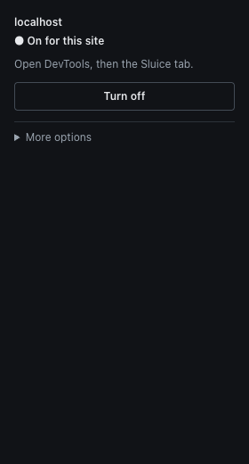
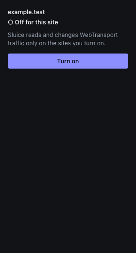
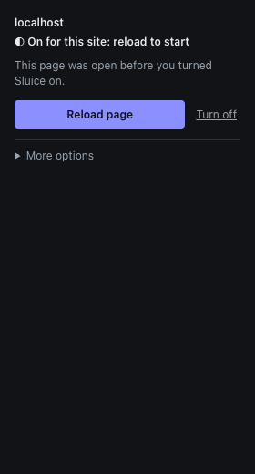
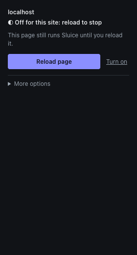
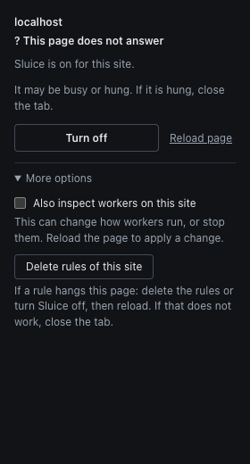
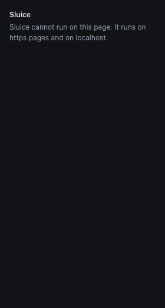
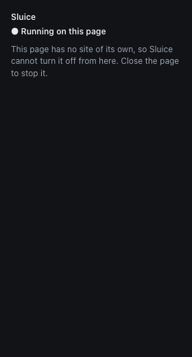

# Turn Sluice on for a site

Sluice does nothing until you turn it on for a site. This keeps it away from sites you did not choose (ADR-8).

## Steps

1. Open the site. It must be an `https` page, or `localhost`, `127.0.0.1` or `[::1]`.
2. Click the Sluice button in the Chrome toolbar. The popup opens.
3. Click **Turn on**. Chrome asks for permission for that site. Accept it.
4. Click **Reload page**. Sluice must be in the page before the page scripts run, so a reload is always needed.

The permission covers all ports of that host. For example, a grant for `localhost` covers
`http://localhost:8080` and `http://localhost:3000`.

To stop, click **Turn off** and reload the page.

## What the popup says

The popup and the toolbar badge ask the page what it really runs (ADR-13). They do not only read the permission.

| Popup text | Badge | Meaning | What to do |
|---|---|---|---|
| On for this site | `ON` (blue) | All is fine. | Open the Sluice tab in DevTools. |
| On for this site: reload to start | none | The permission is there, but the page was loaded before it. | Click **Reload page**. |
| Off for this site: reload to stop | `!` (amber) | You turned the site off, but the open page still has the old script. | Click **Reload page**. |
| Off for this site | none | Sluice does not run here. | Click **Turn on**. |
| This page does not answer | none | The page may be busy or hung, so Sluice cannot tell. | Wait, or close the tab. |

Other states:

- **Sluice cannot run on this page.** The page is not `https` or `localhost`, or it is a browser page such as `chrome://`.
- **Running on this page** (with no site name). The page has no site of its own, for example `about:blank`.
  Sluice cannot turn it off from here. Close the page to stop it.

The popup has one main button: the next useful step. It is **Turn on** when the site is off, **Turn off** when it runs,
and **Reload page** when the page does not match the switch yet (then **Turn on** or **Turn off** is a small link next to
it). **More options** holds the switch for workers and **Delete rules of this site**. It is closed, except on a page that does
not answer.

### Screenshots

On and running:

Off:

On, but the page needs a reload:

Off, but the open page still runs Sluice:

The page does not answer:

A page where Sluice cannot run:

A page with no site of its own:

## If a rule hangs the page

A rule with a slow regex can freeze the page, and then the panel cannot help. The popup still works. In the popup:

1. Click **Turn off**, or open **More options** and click **Delete rules of this site** (it asks you to click twice,
   because it cannot be undone). On a page that does not answer, **More options** is already open.
2. Reload the page. If the reload does not work, close the tab.

A page that is already open keeps deleted rules until it reloads. The popup says so.

## Good to know

- Chrome always shows the install warning "Read and change all your data on all websites". It comes from the DevTools
  panel, not from the per-site permissions. Sluice only runs on sites you turn on.
- A frame of a site you turned on runs Sluice, also inside a page of another site. The popup and badge look only at the
  top page.
- After you update Sluice, reload open pages. An open page keeps the old script.
- The "Turn on" permission dialog of Chrome was not tested by the project, because it cannot be automated.

Next: [the panel](panel.md), [rules](rules.md), [workers](workers.md).
