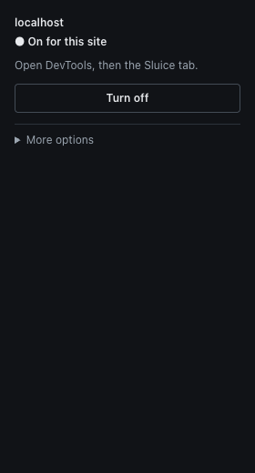

# Workers

Many WebTransport apps, including many MoQ players, open their sessions inside a Web Worker. Sluice can inspect
dedicated workers, but only if you ask for it, for each site. The switch is off by default (ADR-14).

## Turn it on

1. Turn Sluice on for the site (see [turn-on.md](turn-on.md)).
2. In the popup, open **More options** and tick **Also inspect workers on this site**. This option shows only when the site is on.
3. Reload the page.

The popup says "This can change how workers run, or stop them." This is a real risk, so leave the switch off if you
do not need it. Turning Sluice off for the site also ends the switch.

## What you get

- Sessions opened in a worker show in the panel sidebar with the label `worker N, open` (or `closed`).
  Workers with the same URL get different numbers.
- Rules apply to worker traffic, in the same way as for the page (see [rules.md](rules.md)).
- Classic and module workers both work. This was tested, with relative `fetch`, `importScripts` and nested workers.

## How it works, and what it costs

A worker normally loads from the URL you give it. No extension API can add a script to the worker of a page. So with
the switch on, Sluice starts the worker from a `blob:` URL. That script sets up the Sluice runtime first and then
loads the script of your app. Because of this:

- The worker runs under the security policy (CSP) of the **page**, not of its own script.
- Sluice fixes relative URLs for `importScripts`, `fetch`, `new Worker`, `WebSocket` and a few other APIs, and
  `self.location` is a `URL` object, not a `WorkerLocation`. Stack traces show `blob:` URLs.
- Each worker makes **one extra `HEAD` request** for its own script, to find the final URL. If both `HEAD` and a
  fallback `GET` fail, the worker stops with an error.
- Once for each frame, a small probe worker checks if the CSP allows this. Your server sees a `404` for
  `/__sluice_probe__`. On a site where the CSP blocks it, the page can also see one CSP violation.
- The page can see one more key in `sessionStorage`: `sluice-worker-probe:/`.
- If the page has a `connect-src` that allows the site but not the relay, the session in the worker can fail. A
  native worker would connect.

So with the switch on, a worker can behave differently from a native one, or stop.

## What stays native, and why

Some workers cannot be instrumented. They run as normal, with no change, and your app works as before. The panel
lists them: a section **N worker scripts are not inspected** opens above the Messages view, with one reason for each
script. It counts scripts, so workers with one URL are one entry. The section stays after **Clear**.

| Reason in the panel | Why |
|---|---|
| The security policy (CSP) of the page blocks how Sluice starts workers | A CSP `worker-src` (or `child-src`, `script-src`, `default-src`) without `blob:` blocks the start script. Sluice does not force it. |
| It started before Sluice knew if the security policy (CSP) allows it | The probe was not ready. This is common on the first load. Reload to try again. |
| It starts from a blob: URL | Sluice cannot add its start script to a worker that already comes from a `blob:` URL. |
| It starts from a data: URL | Same. |
| The page has too many workers | Only 32 workers in a frame are instrumented. Others stay native. |
| The browser refused the script with Sluice in it | For example, Trusted Types in a `<meta>` tag. |

Under a `require-trusted-types-for` header, workers run native with the CSP reason.

These are **not instrumented at all**, and the panel does not list them:

- `SharedWorker`,
- service workers,
- workers started inside another worker (nested workers).

## Limits

- Sessions in these workers are not seen in the panel and rules do not touch them.
- If a worker crashes, its sessions can look open and its slot stays taken. A worker that does not report for 30 s
  counts as gone until it reports again.
- After you change the switch, reload the page. The checkbox shows the saved switch, not what the open page runs.
- Tested on Chromium 156 only.
